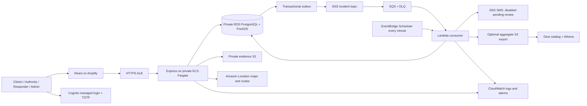

# Architecture

The browser uses a same-origin `/api/v1` interface. In development Vite proxies requests to Express. In AWS Amplify rewrites API paths to an HTTPS Application Load Balancer. The Cognito callback also uses the frontend origin through that proxy, so host-only cookies remain on the browser-facing origin. The proxy must forward cookies and Origin and honor no-store; verify this topology in the deployed browser before release.

## Data and ownership

Cognito authenticates identity; PostgreSQL profiles determine the role, status, permissions, department, jurisdiction and team membership. OAuth code/PKCE exchange happens on the backend. Browser cookies contain a random opaque session handle, not a Cognito refresh token. Refresh tokens are encrypted with an independently generated Secrets Manager key. Server sessions are revoked immediately on local suspension.

Each incident transaction writes the report, matching department records, a status-history entry, in-app control-room alerts, a durable escalation deadline and an outbox event. Control-room alert persistence does not wait for team selection. Availability to a signed-in control room is not proof of delivery or acknowledgement.

Outbox rows are locked during publication. A crash between SNS acceptance and database commit can publish twice; SQS consumers deduplicate using the event UUID. Queue retries use partial batch failures and a DLQ. Local demo mode invokes the same database consumer directly, without representing this as live SNS/SQS validation.

Escalation deadlines are persisted, claimed using `FOR UPDATE SKIP LOCKED`, and audited. Worker timers only poll durable records. EventBridge invokes the AWS worker every minute; the 60-second demo threshold can therefore execute approximately one additional scheduler interval late, plus provider retry delay. This is not a guaranteed emergency response SLA.

For noncritical reports, acknowledgement satisfies the default policy. Critical reports require dispatch. Manual assistance/escalation forces a review even after acknowledgement. Declined/cancelled assignments schedule another review. The final stage records `REGIONAL_REVIEW_REQUIRED`; a regional endpoint is an operational handoff, not a claim of external integration.

## Realtime design

Authenticated Server-Sent Events replace API Gateway WebSockets for this version. The workflow needs server-to-browser updates, while device coordinates use validated HTTPS POSTs. Each stream is tied to one authorized incident and rechecks session validity and incident access every three seconds. Events contain a refresh signal only; the browser fetches scoped status/tracking through protected endpoints. There is no global location broadcast. Reconnect uses EventSource, and a revoked/expired session closes the stream.

Trade-offs: per-connection polling costs and ALB connection usage; multi-instance event fan-out is unnecessary because each task reads durable state. Persistent connections need capacity/load testing. Browser session checks refresh access tokens; a stream with an expired access window closes and the next authorized request refreshes it. Test deployed Amplify streaming behavior before enabling realtime for users; do not describe the local SSE test as cloud transport validation.

## Network and database privileges

Two AZs; public ALB/NAT subnets, private application subnets, isolated database subnets. One NAT gateway in development is a cost/availability compromise. Production increases application tasks and enables Multi-AZ RDS, but still requires operational review of NAT redundancy and quotas.

A dedicated deployment migration Lambda uses the database owner secret. ECS and the worker get a separate `response_app` login, without schema creation, role creation, audit mutation, or migration-table writes. Migration completion is a dependency of ECS service deployment. The system uses TLS certificate validation and the official RDS CA bundle. No database or application secrets appear in frontend configuration or outputs.

See deployment and operations documents for external prerequisites and failure behavior.
