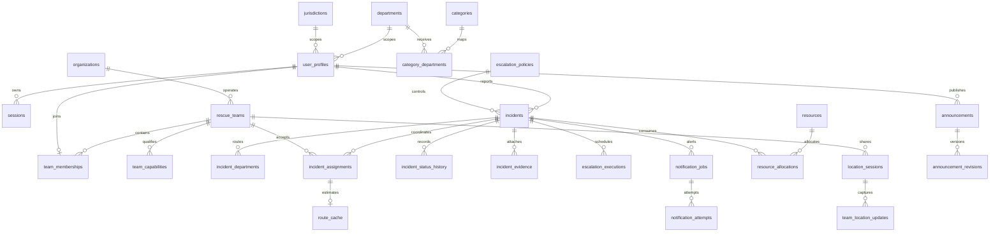

# Database design

PostgreSQL 16, PostGIS 3.5 locally; RDS PostgreSQL 16 in CDK. Migrations are ordered SQL files, recorded in `schema_migrations`, and protected by a transaction-level advisory lock. `001` defines schema, `002` adds operational controls, `003` installs a reference department/category catalog; `004` tracks reopened response cycles separately from earlier completed dispatches. No production demo users, incidents, locations or jurisdictions are seeded.

Additional tables: `roles`, `permissions`, `user_permissions`, `oauth_states`, `audit_events`, `outbox_events`, `processed_events`, `idempotency_keys`, `analytics_exports`, `runtime_heartbeats`.

The single primary role lives in `user_profiles.role`; role grants are not duplicated in a separate assignment table. Incident `kind=EMERGENCY` represents emergency requests, with `/emergency-requests` sharing the validated incident implementation. Latitude/longitude use SRID 4326 `geography(Point)`; jurisdictions use indexed `geometry(MultiPolygon,4326)`. PostGIS `ST_DWithin` and `ST_Distance` use metres. `ST_Covers` enforces operating area. GiST indexes support spatial queries.

Team eligibility requires department match, configured capabilities with unexpired certifications, jurisdiction coverage, on-duty availability, capacity, active authorized location sharing, location accuracy at most 200 metres, a sample newer than five minutes, and radius. Live presentation is stricter: 90 seconds. The difference supports candidate search without falsely showing old GPS as live.

Assignments and resources lock their capacity row before allocating. Unique partial indexes prevent duplicate active assignments. Critical creation uses an actor-scoped idempotency key plus request hash; reusing a key for changed input returns conflict. Each status transition is validated and audited. Audit/status/revision records reject update/delete; the production runtime login also lacks those grants. Database owners are trusted operators and can administer schema; append-only tables are not cryptographic tamper proof.

Location history defaults to 24 hours and is configurable from 1–168 hours. The worker deletes expired historical coordinates and clears old team coordinates. Incidents, session identifiers and evidence metadata have independent retention responsibilities described in operations. S3 evidence expires after 90 days; historical versions after 30 days. Do not assume regulatory retention compliance without a jurisdiction-specific policy.
